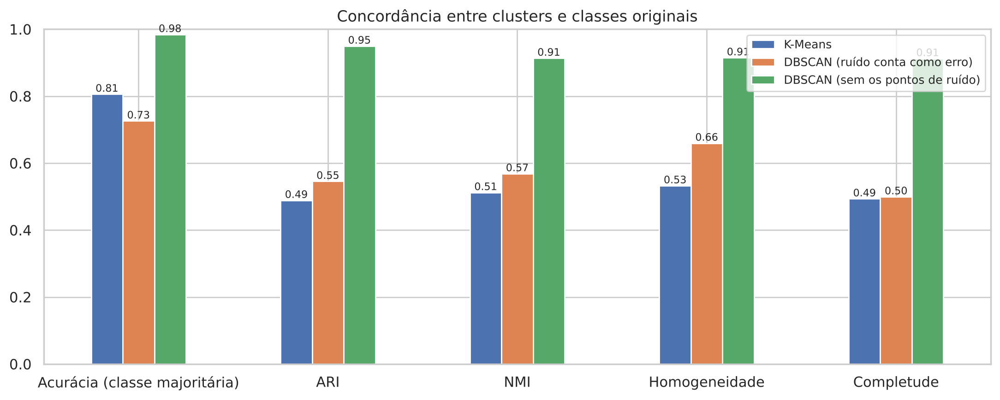
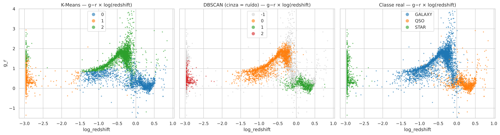
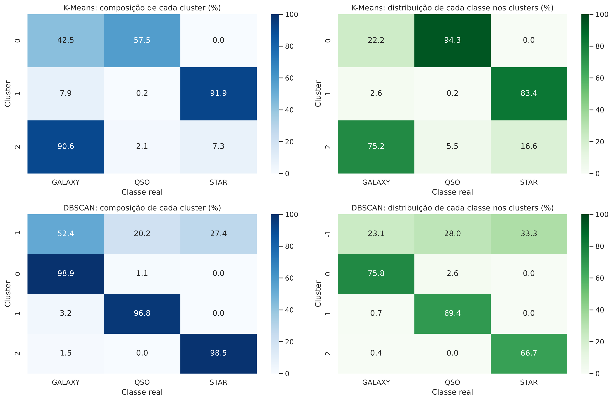

# Clusterização Estelar com K-Means e DBSCAN

Agrupamento **não supervisionado** de objetos astronômicos do Sloan Digital Sky Survey (SDSS). O objetivo foi ver se os clusters encontrados sem rótulos recuperam as classes reais: **GALAXY**, **STAR** e **QSO** (quasar).

Atividade 11 (Clusterização) da disciplina de Inteligência Artificial e Data Science. Continua o projeto [classificacao-estelar-ml](https://github.com/Naty-29/classificacao-estelar-ml), que usou a mesma base com modelos supervisionados.

## Dataset

- **Fonte:** [Stellar Classification Dataset - SDSS17](https://www.kaggle.com/datasets/fedesoriano/stellar-classification-dataset-sdss17) (Kaggle, autor: fedesoriano)
- **Arquivo:** `data/processed/star_classification_tratado.csv`. É a base tratada do projeto anterior, com 99.999 registros e sem o outlier `-9999`.
- **Amostra:** 5.000 registros, estratificada por classe (`random_state = 42`)
- **A coluna `class` é removida antes da clusterização.** Ela só é usada na avaliação final.

## Atributos usados

| Atributo | Descrição |
|---|---|
| `u_g`, `g_r`, `r_i`, `i_z` | Cores fotométricas (diferença entre magnitudes de filtros vizinhos) |
| `log_redshift` | Logaritmo do redshift |

Todos os atributos foram padronizados com `StandardScaler`. A posição no céu (`alpha`, `delta`) foi descartada porque não tem relação com o tipo do objeto.

## Etapas

1. **K-Means** (k = 3), com análise de cotovelo e silhueta
2. **DBSCAN**, com `eps` e `min_samples` escolhidos pelo gráfico de k-distância e por uma busca em grade sem usar a classe. Critérios: 3 clusters, até 30% de ruído, nenhum cluster menor que 5% e maior silhueta.
3. Gráficos de dispersão (PCA e g−r × log(redshift))
4. Heatmaps de correlação entre clusters e atributos
5. Comparação dos clusters com as classes originais: tabelas cruzadas, acurácia por classe majoritária, ARI, NMI, homogeneidade e completude

## Resultados

| Modelo | Acurácia* | ARI | NMI |
|---|---|---|---|
| K-Means | 0,81 | 0,49 | 0,51 |
| DBSCAN (ruído conta como erro) | 0,73 | 0,55 | 0,57 |
| DBSCAN (só pontos agrupados, 74% da amostra) | 0,98 | 0,95 | 0,91 |

\* Cada cluster recebe a classe majoritária dos seus pontos.







As conclusões completas estão no final do notebook.

## Estrutura

```
clusterizacao-estelar-ml/
├── README.md
├── requirements.txt
├── data/processed/star_classification_tratado.csv
├── img/                      # figuras usadas neste README
└── notebooks/atv_11_clusterizacao.ipynb
```

## Como executar

```bash
pip install -r requirements.txt
jupyter notebook notebooks/atv_11_clusterizacao.ipynb
```
